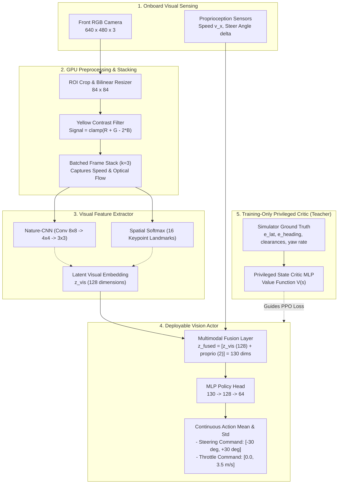

# CNN Perception & Policy Architecture

Comprehensive guide to the visual perception pipeline, convolutional neural network (CNN) feature extractors, and Asymmetric Actor-Critic reinforcement learning policy for the **Leatherback Racer**.

---

## 1. Visual Verification Overview

Below is the 4-stage visual perception pipeline running on actual camera frames captured in Isaac Sim:


```text
[1. Raw Camera (640x480)] ──► [2. ROI Crop & Resize (84x84)] ──► [3. Yellow Contrast Filter] ──► [4. Spatial Keypoints]
```

1. **Panel 1 (Raw Onboard Camera):** Full 640x480 RGB camera feed mounted on the front chassis bumper.
2. **Panel 2 (ROI Crop & Resize):** Removes non-informative sky (top 25%) and vehicle hood (bottom 5%), then downsamples to 84x84 to allow massive parallel simulation on GPU.
3. **Panel 3 (Yellow-Line Isolation Channel):** Enhances boundary contrast via `clamp(R + G - 2*B)`, isolating bright yellow stripes while asphalt drops to zero.
4. **Panel 4 (Spatial Softmax Keypoints):** 16 learned 2D coordinate landmarks automatically tracking the left and right boundary curves.

---

## 2. End-to-End System Pipeline



---

## 3. Pipeline Stages

### Stage 1: GPU Image Preprocessing (`VisionPreprocessor`)
* **Source:** `src/leatherback_racer/vision/transforms.py`

Feeding high-resolution (640x480) images directly into reinforcement learning networks creates severe GPU memory bottlenecks. The preprocessor applies four fast GPU operations:

1. **Normalization:** Converts `uint8` [0, 255] images to float32 tensors in [0.0, 1.0].
2. **Horizon & Hood Crop:**
   - Cuts the **top 25%** of the image (sky, horizon, and distant background).
   - Cuts the **bottom 5%** (front bumper chassis edge).
   - Forces the network to focus strictly on the driving corridor ahead.
3. **Bilinear Downsampling:** Resizes cropped images to **84x84**, enabling thousands of parallel simulator environments to run simultaneously.
4. **Color Isolation (`yellow_contrast` mode):**
   ```text
   Signal = clamp(R + G - 2 * B, 0.0, 1.0)
   ```
   Because racing yellow has high red and green with near-zero blue (`[1.0, 0.82, 0.0]`) and tarmac is neutral grey (`[0.12, 0.12, 0.12]`), subtracting `2*B` makes the boundary lines glow while the asphalt drops to zero.

---

### Stage 2: Temporal Frame Stacking (`BatchedFrameStack`)
* **Source:** `src/leatherback_racer/vision/frame_stack.py`

A single static image tells you **where** the vehicle is, but provides **zero information about how fast the car is moving, accelerating, or spinning**.

* We maintain a circular GPU buffer of the last `k=3` consecutive frames: `[Frame_t, Frame_{t-1}, Frame_{t-2}]`.
* The resulting tensor has shape: `(Batch, 3 * Channels, 84, 84) = (Batch, 9, 84, 84)`.
* **Why this works:** The difference across consecutive frames creates **optical flow** in pixel space. The CNN directly perceives forward velocity, braking deceleration, and vehicle slip angle without needing an external speedometer or IMU.

---

### Stage 3: Visual Feature Extraction (`cnn_encoders.py`)
* **Source:** `src/leatherback_racer/models/cnn_encoders.py`

We provide two swappable visual feature extractors:

#### Option A: Nature-CNN Architecture (Mnih et al., 2015)
Standard deep RL vision backbone:
- **Conv Layer 1:** 8x8 kernel, stride 4, 32 channels. Detects road boundaries and high-contrast edges.
- **Conv Layer 2:** 4x4 kernel, stride 2, 64 channels. Detects curve apexes and vanishing lines.
- **Conv Layer 3:** 3x3 kernel, stride 1, 64 channels. Captures spatial layout and look-ahead trajectory.
- **Dense Projection:** Projects flattened conv features into a compact 128-dimensional embedding `z_vis` with LayerNorm.

#### Option B: Spatial Softmax Keypoint Encoder (Levine et al., 2016)
Specially engineered for lane tracking and visual servoing:
- Passes through conv layers to produce `K=16` spatial heatmaps.
- Computes the expected `(x, y)` coordinate center-of-mass for each heatmap using a 2D softmax over the pixel grid.
- Outputs 16 explicit 2D keypoints `(x_k, y_k)` in [-1.0, 1.0] directly tracking line curvature (visualized in Panel 4 of the verification image).

---

### Stage 4: Multimodal Actor Policy (`VisionActor`)
* **Source:** `src/leatherback_racer/models/policy.py`

The Actor policy is the **only network deployed on the physical vehicle**:

```text
[Visual Embedding: z_vis (128)] + [Proprioception: (steer_angle, speed_vx) (2)]
                              │
                              ▼
             Concatenated Vector (130 dims)
                              │
                              ▼
             Linear(130 -> 128) + LayerNorm + ReLU
                              │
                              ▼
             Linear(128 -> 64)  + LayerNorm + ReLU
                              │
                              ▼
                  Action Head (Linear -> tanh)
                              │
         ┌────────────────────┴────────────────────┐
         │                                         │
   Steering Command                          Throttle Command
   [-1.0, +1.0] -> [-30 deg, +30 deg]        [-1.0, +1.0] -> [0.0, 3.5 m/s]
```

---

### Stage 5: Asymmetric Actor-Critic (`PrivilegedCritic`)
* **Source:** `src/leatherback_racer/models/policy.py`

Training an end-to-end vision policy with standard PPO from scratch is notoriously sample-inefficient because estimating state values `V(s)` from raw camera pixels introduces high variance. 

We solve this using **Asymmetric Actor-Critic**:

| Component | Observation Source | Role | Used During |
|---|---|---|---|
| **Actor (Student)** | Camera Images + Proprioception | Generates Steering & Throttle | **Training & Real-World Deployment** |
| **Critic (Teacher)** | Privileged Simulator State (`e_lat`, `e_heading`, clearances, velocities) | Computes baseline `V(s)` for PPO advantage estimation | **Simulation Training Only (Discarded for Deployment)** |

**Why this is effective:** The Critic learns an accurate value function in just a few epochs because it has ground-truth geometry. Its low-variance advantage estimates guide the vision actor's policy gradient updates directly, cutting training sample complexity by roughly 10x.

---

## 4. CNN Layer Mathematics & Dimension Tracing

### The 2D Convolution Dimension Formula
For any `nn.Conv2d` layer, output height and width are calculated as:

```text
output_size = ((input_size - kernel_size + 2 * padding) // stride) + 1
```

Where `//` represents integer division (rounding down).

---

### Layer-by-Layer Calculation for (84x84) Input

```text
Input Frame Stack: (Batch, 9 channels, 84 height, 84 width)
       │
       ▼  Conv 1: 32 filters, kernel=8, stride=4, padding=0
Feature Map 1: (Batch, 32, 20, 20)
       │
       ▼  Conv 2: 64 filters, kernel=4, stride=2, padding=0
Feature Map 2: (Batch, 64, 9, 9)
       │
       ▼  Conv 3: 64 filters, kernel=3, stride=1, padding=0
Feature Map 3: (Batch, 64, 7, 7)
       │
       ▼  Flatten: 64 * 7 * 7 = 3,136
Flattened Vector: (Batch, 3136)
       │
       ▼  Linear(3136 -> 128) + LayerNorm + ReLU
Latent State Vector: (Batch, 128)
```

#### Layer 1: Downsampling & Stripe Detection
* **Input:** `(Batch, 9, 84, 84)`
* **Layer Config:** `kernel = 8`, `stride = 4`, `padding = 0`, `out_channels = 32`
* **Calculation:**
  ```text
  output_size = ((84 - 8 + 0) // 4) + 1
              = (76 // 4) + 1
              = 19 + 1
              = 20
  ```
* **Output Shape:** `(Batch, 32, 20, 20)`
* **Design Rationale:** In an 84x84 image, the 8 cm wide yellow track stripe spans roughly 6 to 10 pixels across. An 8x8 kernel matches this exact thickness, capturing the line and its contrast with tarmac in one pass. Stride 4 cuts pixel resolution by 4x.

#### Layer 2: Shape & Tangent Detection
* **Input:** `(Batch, 32, 20, 20)`
* **Layer Config:** `kernel = 4`, `stride = 2`, `padding = 0`, `out_channels = 64`
* **Calculation:**
  ```text
  output_size = ((20 - 4 + 0) // 2) + 1
              = (16 // 2) + 1
              = 8 + 1
              = 9
  ```
* **Output Shape:** `(Batch, 64, 9, 9)`
* **Design Rationale:** Halves resolution from 20x20 to 9x9 while doubling channels to 64. Combines simple edge fragments into continuous curves and corners.

#### Layer 3: Spatial Layout & Vanishing Points
* **Input:** `(Batch, 64, 9, 9)`
* **Layer Config:** `kernel = 3`, `stride = 1`, `padding = 0`, `out_channels = 64`
* **Calculation:**
  ```text
  output_size = ((9 - 3 + 0) // 1) + 1
              = (6 // 1) + 1
              = 6 + 1
              = 7
  ```
* **Output Shape:** `(Batch, 64, 7, 7)`
* **Design Rationale:** Uses stride 1 to refine spatial relationships between the left and right boundary curves without further downsampling.

---

### Receptive Field Evolution
The **receptive field** is the area of the original 84x84 image that an individual neuron "sees":

| Layer | Kernel | Stride | Receptive Field on 84x84 Image | Role in Driving |
|---|---|---|---|---|
| **Input** | — | — | **1 x 1 pixel** | Raw single pixel color |
| **Conv 1** | 8 | 4 | **8 x 8 pixels** | Detects local yellow stripe edge |
| **Conv 2** | 4 | 2 | **20 x 20 pixels** | Detects road curve orientation |
| **Conv 3** | 3 | 1 | **36 x 36 pixels** | Compares left and right lines together |

Because the final conv neurons have a 36x36 receptive field (spanning nearly half the entire image), individual neurons can compare the position of the left yellow line against the right yellow line to determine whether the car is centered in the corridor.

---

## 5. How the CNN Learns to Center the Vehicle

There are **no manually labeled images** (no human draws bounding boxes). The CNN learns entirely through trial, error, and simulator rewards:

```text
[Simulator Oracle knows true vehicle position]
                    │
                    ▼
       Compute Centerline Reward:
       - Perfectly Centered:  +1.0 Reward
       - Drifting off-center: +0.1 Reward
       - Touching yellow line: -5.0 Penalty
       - Crossing boundary:   -20.0 (Crash & Reset)
                    │
                    ▼
       PPO Backpropagation Signal:
       Reward -> Policy Head -> MLP -> Conv 3 -> Conv 2 -> Conv 1 -> Filter Weights
```

1. If the car drifts to the right, both yellow lines shift leftward across the camera pixel matrix.
2. If the policy randomly outputs a **left steering command**, the car moves back toward the center.
3. The simulator immediately awards a **high positive reward (+1.0)**.
4. Backpropagation adjusts the filter weights so that whenever this visual pattern (lines shifted left) appears, the probability of steering left increases.
5. Over thousands of episodes, the filters automatically specialize into line detectors and corridor-symmetry detectors.

---

## 6. Measured Benchmark Performance

Measured via `scripts/test_cnn_perception.py` on CUDA GPU:

| Metric | Measured Value | Requirement / Significance |
|---|---|---|
| **Step Latency (Batch=32)** | **0.29 ms** per batch | Far faster than the 10.0 ms target (100 Hz control) |
| **GPU Inference Throughput** | **109,385 frames / second** | Massive parallel simulation capacity |
| **Total Policy Parameters** | **560,485 parameters** | Ultra-lightweight (< 2.5 MB) |
| **Nature-CNN Parameters** | **490,016 parameters** | Compact visual backbone |
| **Spatial-Softmax Parameters** | **79,312 parameters** | Keypoint alternative (< 350 KB) |
| **Action Dimension** | **2 continuous outputs** | Steering: `[-30 deg, +30 deg]`, Throttle: `[0, 3.5 m/s]` |
