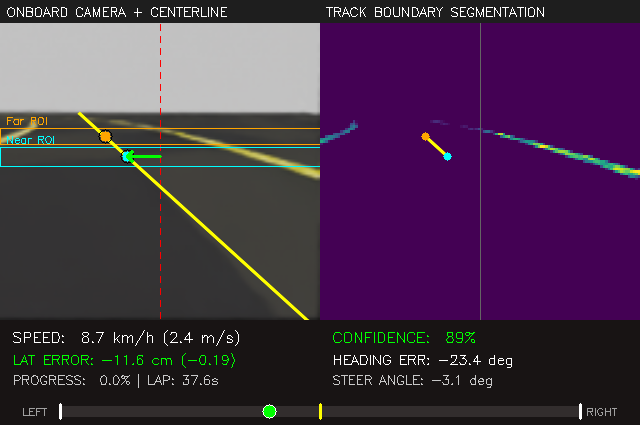
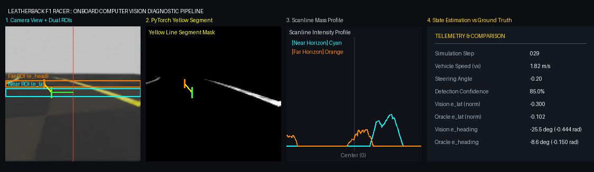

# F1 Racer

Vision-based autonomous racing for the **NVIDIA Leatherback** car in **Isaac Lab 3.0**.

The car learns to complete procedurally generated tracks with PPO. The deployed actor never receives ground-truth
track coordinates: it sees only a single onboard camera and the car's own motion state. A privileged ground-truth
state is used by the critic during training.





## What is in this repo

- **Leatherback car environment** with double-wishbone suspension, steering knuckles, and four-wheel drive.
- **Isaac Lab task** registered as `F1RacerRl-F1-Racer-F1-Car`.
- **Vision-only actor** with a 7D state: lateral error, heading error, detection confidence, body velocities, yaw
  rate, and steering angle.
- **Privileged critic** with an 8D ground-truth state for asymmetric actor-critic PPO.
- **Classical GPU vision** that isolates the yellow track boundaries with a chromaticity mask (`R + G - 2B`) and
  extracts near/far lookahead errors. No neural network is used for perception.
- **Procedural tracks** generated from splines, with an analytical track oracle for ground-truth projection.
- **Single-lap evaluation** on a fresh unseen track, with a live vision HUD and a performance scorecard.
- **Keyboard teleoperation** for manually checking suspension, grip, steering, and the vision pipeline.

## Requirements

- Linux (Ubuntu 22.04 or 24.04 recommended)
- NVIDIA GPU with a recent driver and CUDA support
- Python 3.12
- [Isaac Lab 3.0](https://github.com/isaac-sim/IsaacLab) installed and working
- [uv](https://docs.astral.sh/uv/getting-started/installation/) for the task environment

## Installation

Clone the repository:

```bash
git clone https://github.com/AbdelbakiJeddi/f1_racer.git
cd f1_racer
```

The Isaac Lab task package resolves Isaac Lab from a local source checkout. Before syncing, open
`f1_racer_rl/pyproject.toml` and update the paths under `[tool.uv.sources]` so they point at your Isaac Lab
installation. The checked-in paths are relative to `f1_racer_rl/` and assume Isaac Lab is five directories above
it. With this repository at `~/Desktop/Abok/robotics-rl/f1_racer`, for example, they resolve to `~/IsaacLab-3.0`.

```bash
cd f1_racer_rl

# Newton backend, no Isaac Sim
uv sync

# Isaac Sim / Kit rendering, used by the camera and live HUD
uv sync --extra isaacsim
```

`uv sync` installs both `f1_racer_rl` and the root `leatherback-racer` package. If you prefer to use an existing
Isaac Lab Python environment instead of the uv environment, install both packages editable from the repository
root:

```bash
pip install -e .
pip install -e f1_racer_rl --no-deps
```

## Quick start

Run training and playback from `f1_racer_rl/`. Run the custom scripts from the repository root with the same
environment active. The commands below use `uv run` and assume the `isaacsim` extra is available; drop
`--extra isaacsim` if your environment already includes Isaac Sim.

### Train

```bash
# Fast headless training
uv run --extra isaacsim isaaclab train \
  --rl_library rsl_rl \
  --task F1RacerRl-F1-Racer-F1-Car \
  --num_envs 64 \
  --max_iterations 500

# Visualized training
uv run --extra isaacsim isaaclab train \
  --rl_library rsl_rl \
  --task F1RacerRl-F1-Racer-F1-Car \
  --num_envs 1 \
  --viz kit

# Resume from the latest checkpoint
uv run --extra isaacsim isaaclab train \
  --rl_library rsl_rl \
  --task F1RacerRl-F1-Racer-F1-Car \
  --checkpoint latest
```

Checkpoints and TensorBoard events are written under `logs/rsl_rl/`.

### Play a checkpoint

```bash
uv run --extra isaacsim isaaclab play \
  --rl_library rsl_rl \
  --task F1RacerRl-F1-Racer-F1-Car \
  --checkpoint latest \
  --viz kit
```

### Single-lap evaluation on an unseen track

From the repository root:

```bash
uv run --project f1_racer_rl --extra isaacsim python scripts/test_single_lap.py \
  --track_type organic \
  --seed 123 \
  --viz kit
```

Options:

| Flag | Description |
| --- | --- |
| `--track_type` | `organic`, `wavy_circle`, or `circuit` (default: `organic`) |
| `--seed` | Procedural track seed (default: `123`) |
| `--radius` | Base track radius in metres (default: `13.0`) |
| `--amplitude` | Curve amplitude in metres (default: `2.2`) |
| `--checkpoint` | Checkpoint path or `latest` (default: `latest`) |
| `--chase_cam` | Use a third-person chase camera instead of the free camera |
| `--show_vision` / `--no_show_vision` | Toggle the live OpenCV vision HUD |

Generated tracks and the evaluation snapshot are saved under `outputs/eval_track/`.

### Manual driving

```bash
uv run --project f1_racer_rl --extra isaacsim python scripts/teleop_car.py
```

Controls, after clicking inside the 3D viewport:

| Key | Action |
| --- | --- |
| `W` / `Up` | Accelerate |
| `S` / `Down` | Brake / reverse |
| `A` / `Left` | Steer left |
| `D` / `Right` | Steer right |
| `Space` | Handbrake |
| `R` | Reset to the start line |

### Vision diagnostics

```bash
uv run --project f1_racer_rl --extra isaacsim python scripts/test_vision_pipeline_live.py --steps 30
```

This renders the camera, runs the boundary segmentation, compares vision errors against the track oracle, and
saves a four-panel dashboard to `outputs/vision_pipeline_dashboard.png`.

### TensorBoard

```bash
uv run --project f1_racer_rl tensorboard --logdir logs/rsl_rl/f1_racer_leatherback --port 6006
```

## How it works

The actor observes the track through a 128x128 nose camera. The vision detector samples two lookahead regions,
finds the left and right yellow boundary centroids, and converts their positions into lateral error, heading
error, and confidence. Those three values are combined with the car's forward/lateral velocity, yaw rate, and
steering angle to form the 7D policy input.

The critic additionally sees the analytical ground-truth errors from the track oracle, making this an asymmetric
actor-critic setup. Rewards combine centre-line tracking, forward progress, heading alignment, boundary proximity,
and steering smoothness. Episodes terminate when the car leaves the track or rolls over.

Training tracks are procedural. The car spawns on a generated centre line, and the same geometry is used to build
the USD boundary ribbons and the oracle cache. Evaluation can therefore generate a new track from a seed and test
the policy on geometry it has never seen.

For class responsibilities and data flow, see [`ARCHITECTURE.md`](ARCHITECTURE.md).

## Project layout

```text
f1_racer/
├── README.md
├── ARCHITECTURE.md
├── assets/                         # README screenshots
├── pyproject.toml                  # leatherback-racer package
├── scripts/
│   ├── teleop_car.py               # Keyboard driving + live vision HUD
│   ├── test_single_lap.py          # Unseen-track lap evaluation
│   └── test_vision_pipeline_live.py
├── src/leatherback_racer/
│   ├── evaluation/                 # Checkpoint loading, lap evaluation, diagnostics
│   ├── teleop/                     # Keyboard input
│   ├── track/                      # Procedural tracks and analytical oracle
│   ├── vision/                     # Boundary detector and HUD
│   └── arena/                      # Backward-compatible alias for track
└── f1_racer_rl/
    ├── README.md                   # Task package notes
    ├── pyproject.toml              # Isaac Lab extension and uv sources
    └── src/f1_racer_rl/
        ├── assets/                 # Leatherback USD, track USD/NPZ data
        └── tasks/f1_racer/
            ├── config/f1_car/      # Environment registration and PPO config
            └── mdp/                # Observations, rewards, events, terminations
```

Generated at runtime and intentionally not committed: `logs/`, `outputs/`, and `f1_racer_rl/.venv/`.

## Troubleshooting

- **`ModuleNotFoundError: f1_racer_rl`** — run commands through `uv run` from `f1_racer_rl/`, or install the
  packages into the active environment.
- **`uv sync` cannot resolve Isaac Lab** — check the paths in `[tool.uv.sources]` inside
  `f1_racer_rl/pyproject.toml`.
- **No 3D window / Kit fails to start** — install the `isaacsim` extra and pass `--viz kit`.
- **Camera or HUD is blank** — make sure Isaac Sim rendering is available and the GPU is visible to the process.
- **Checkpoint not found** — train a policy first, or pass an explicit path with `--checkpoint`.
- **Track evaluation looks wrong for a seed** — try another `--track_type` or seed; procedural geometry can
  occasionally create tight sections that the current policy cannot handle.

## License and credits

This project is released under the BSD-3-Clause license. See [`LICENSE`](LICENSE).

The Leatherback robot asset and parts of the Isaac Lab task scaffolding are derived from the Isaac Lab project and
retain their original copyright headers. See the file headers and the Isaac Lab repository for details.
